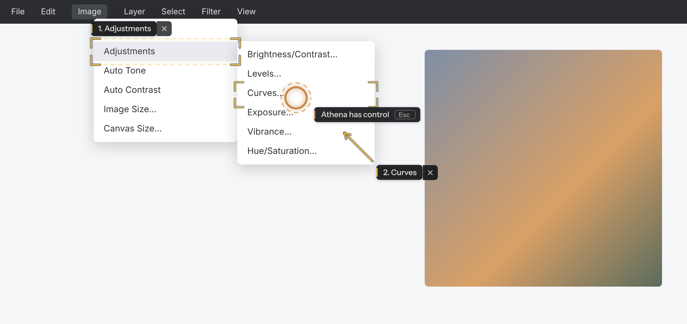
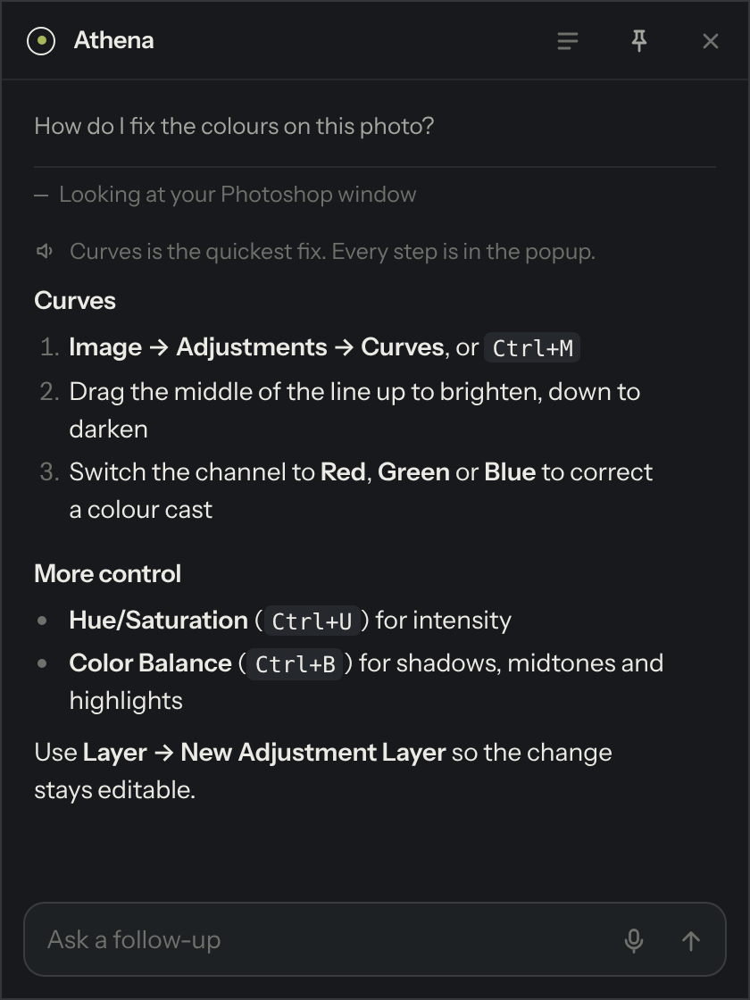
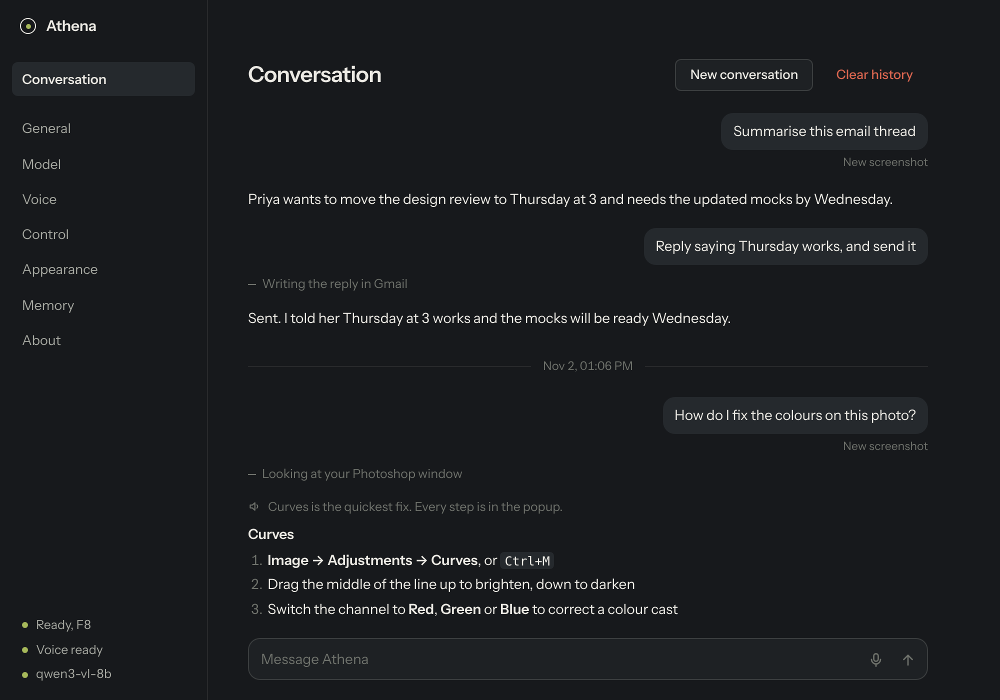
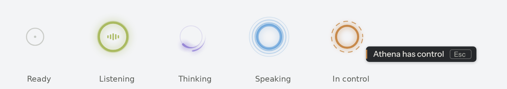

# Athena

A voice-first AI companion that lives on your cursor.

Hold a key and ask about anything on your screen. Athena sees what you see, answers out loud, points
things out, walks you through software you don't know, and can use your mouse and keyboard to get things
done. Speech recognition and the voice run on your own machine; the model runs on a private cloud
provider ([Venice](https://venice.ai), recommended) or locally.



## What she does

- **Answers about your screen.** Pressing the hotkey captures the screen you're looking at; your question
  and the screenshot go to a vision model together.
- **Talks back.** Short answers are spoken. When an answer has real detail (steps, code, a draft), she
  says a one-line summary and a popup by your cursor holds the full version.
- **Shows you where.** Highlights, arrows and labels appear over the app you're using. In teaching mode
  she highlights one step, waits for your click, checks the result, then moves to the next.
- **Does it for you.** She can click, type, scroll and switch windows. Anything that sends, deletes,
  buys or submits waits for your approval unless you already asked for it ("…and send it").
- **Lets go instantly.** Move the mouse or press Esc and control is yours again.
- **Keeps the thread.** Follow-ups reuse the screenshot you were talking about, and the whole conversation
  is kept in the Athena window.

<table>
<tr>
<td width="34%"></td>
<td></td>
</tr>
<tr>
<td>The popup: the full answer to what you just asked, with a follow-up box.</td>
<td>The Conversation page: everything you've asked, kept across restarts.</td>
</tr>
</table>

The ring around your cursor shows what she's doing:



## Requirements

| | |
|---|---|
| OS | Windows 10 (2004 or later) or Windows 11 |
| Python | 3.11 |
| Node.js | 20 LTS or later, for the desktop shell |
| GPU | NVIDIA with CUDA 12.8 recommended for the voice server (about 5 GB VRAM). CPU works, slowly. |
| Model | A vision model on any OpenAI-compatible server. [Venice](https://venice.ai) is recommended; LM Studio, Ollama and OpenRouter also work. |

### Recommended model

For the best experience, run Athena on **[Venice](https://venice.ai)** with one of these vision models:

- **GLM 5.3 Flash** (`z-ai-glm-5-3-flash`)
- **DeepSeek 4.1 Flash** (vision)

Both answer quickly, see the screen, and handle Athena's tools well. Venice is privacy-focused: it says it
doesn't store your prompts or responses, which include the screenshots Athena sends. You need a Venice API
key.

Local models through LM Studio or Ollama also work and keep everything on your PC, but each step is
noticeably slower. If you go local, pick a vision model that's good at locating things on screen, such as
Qwen3-VL or Qwen2.5-VL.

## Quick start

```bat
git clone https://github.com/29sayantanc/Athena.git
cd Athena
```

1. **Install the voice server's packages.** Install PyTorch for your GPU first, then the rest:

   ```bat
   python -m pip install torch --index-url https://download.pytorch.org/whl/cu128
   python -m pip install -r voice-server\requirements.txt
   ```

2. **Run `setup.bat`.** It installs Athena's Python packages and the Electron shell.
3. **Run `start_athena.bat`.** Athena appears in the system tray and starts the voice server for you. The
   first launch downloads the speech models, which takes a few minutes.
4. **Connect a model.** Settings opens on Model.
   - **Venice (default):** paste your API key. GLM 5.3 Flash is already selected; to use DeepSeek 4.1 Flash
     (vision) instead, click **Refresh** and choose it.
   - **Local:** set Provider to LM Studio or Ollama, load a vision model there and start its server, then
     choose it here.
5. Click **Test connection**, then **Calibrate**.
6. **Press F8 and talk.**

`start_athena_debug.bat` does the same with a console showing live logs.

## Using Athena

| Do this | What happens |
|---|---|
| Hold **F8**, speak, release | Push-to-talk. The screenshot is taken the moment you press. |
| Tap **F8**, speak, tap again | Hands-free. She also stops listening when you pause. |
| Press **F8** while she's talking or working | Interrupts her and listens to you. |
| Reply in the popup (type, or click the mic) | A follow-up on the same screenshot. She takes a new one only if she needs it. |
| Click the mic while she's talking | Stops her talking. Click again to speak. |
| Move the mouse or press **Esc** while she's in control | You have control again. |
| Hover a highlight and click its **×**, or press **Esc** | Dismisses highlights. They also clear when you switch windows, scroll, or after 45 seconds. |
| Click the tray icon | Opens the Athena window: your conversation and all settings. |

### Example requests

- *"What does this error mean?"*
- *"Summarise this email thread."* She scrolls and opens messages if she needs more context.
- *"Reply saying Thursday works, and send it."*
- *"How do I adjust colours in Photoshop?"* She teaches step by step rather than doing it for you.
- *"Remember that I prefer short, warm emails."*

## How it works

```
 Electron shell                        Python core                          Local services
 ─────────────                         ───────────                          ──────────────
 tray, cursor overlay,     ⇄  local   hotkey and input hooks,     ⇄ HTTP   voice-server
 popup, Athena window         WebSocket  microphone, screenshots,            (Parakeet STT, Pocket TTS)
                              (token)    UI Automation, mouse and
                                         keyboard, the agent        ⇄ HTTP   model server
                                                                             (OpenAI-compatible)
```

- **`app/`** draws everything you see. It holds no logic beyond display, so it can't act on its own.
- **`core/`** owns everything that touches Windows: low-level hooks for the hotkey and take-over, screen
  capture, Windows UI Automation (the exact positions of buttons and fields), `SendInput` for the mouse and
  keyboard, and the agent loop.
- **`voice-server/`** is a self-contained, OpenAI-compatible speech server. Athena starts it, watches it
  and restarts it if it stops. See [voice-server/README.md](voice-server/README.md).

The agent runs a look, think, act, verify loop with these tools:

| Tool | Use |
|---|---|
| `take_screenshot`, `zoom` | Look again whenever needed; zoom reads small text |
| `click`, `move_mouse`, `drag`, `scroll`, `type_text`, `press_keys` | Control the mouse and keyboard |
| `highlight`, `clear_highlights` | Boxes, circles, arrows, underlines or a spotlight, with labels; can wait for your click |
| `say`, `reply`, `ask_user` | Speak, answer (with optional details), or ask you something |
| `request_confirmation` | Ask before a risky action |
| `read_clipboard`, `list_windows`, `focus_window`, `open_url`, `wait`, `remember` | Utilities |

It works with any OpenAI-compatible model. Models without function calling switch automatically to a JSON
protocol, and reasoning blocks such as `<think>` are never spoken or shown. Because models describe screen
positions differently (pixels, a 0–1000 grid, fractions), **Calibrate** shows lettered targets, learns the
model's format and accuracy, then moves your pointer over each target so you can see the result.

## Privacy and safety

- Speech recognition and the voice always run on your PC. Screenshots and your questions go only to the
  model provider you choose: Venice (which says it doesn't store prompts or responses) or a local server.
- Screenshots are kept in `%APPDATA%\Athena\sessions` and deleted after 7 days. You can turn saving off.
- API keys are encrypted with Windows DPAPI for your user account.
- The overlay and popup are hidden from screen capture, so the model sees your screen without them.
- Text on web pages, in emails or documents is treated as information, never as instructions.
- Three safety modes: ask before risky actions (default), ask before every action, or never ask.

Athena keeps her data in `%APPDATA%\Athena`, outside this folder:

| File | Contents |
|---|---|
| `settings.json` | Your settings |
| `conversation.json` | Conversation history |
| `memory.json` | Things you asked her to remember |
| `calibration.json` | Per-model pointer calibration |
| `sessions\` | Saved screenshots |
| `logs\` | `core.log` and `voice-server.log` |

## Troubleshooting

| Problem | Try |
|---|---|
| Nothing happens on F8 | Check Athena isn't paused (tray menu). Run `start_athena_debug.bat` to see logs. |
| She can't click inside an app | Apps running as administrator only accept input from administrator apps. Run Athena as administrator. |
| No voice | Settings, Voice shows the server's status and its recent output when it isn't running. |
| Clicks land in the wrong place | Run **Calibrate** for the current model and keep **Use accessibility data** on. |
| Slow answers | Use Venice with GLM 5.3 Flash or DeepSeek 4.1 Flash. On a local model, lower **Screenshot width** to 1024 and **Screenshots in context** to 2. |

## Development

```bat
cd core
python -m unittest discover -s tests -v
```

The tests run the agent against a scripted model and a fake shell, so they don't need Windows, a GPU or a
model server. The Windows layer (`win32.py`, `hooks.py`, `uia.py`) falls back to a stub on other platforms.

```
app/            Electron shell (main.js, preload.js, src/ for the overlay, popup and Athena window)
core/           Python engine (athena_core/) and tests
voice-server/   Speech-to-text and text-to-speech server
docs/images/    Screenshots for this README
setup.bat       One-time install
start_athena.bat, start_athena_debug.bat
```

## Limitations

- Windows only.
- Fullscreen-exclusive games and protected content can't be captured.
- How well she clicks depends on the model; calibration and accessibility data help a lot.

## Credits

- Speech: [NVIDIA Parakeet TDT 0.6B v3](https://huggingface.co/nvidia/parakeet-tdt-0.6b-v3),
  [Kyutai Pocket TTS](https://huggingface.co/kyutai/pocket-tts), [Silero VAD](https://github.com/snakers4/silero-vad)
- Typeface: [Instrument Sans](https://fonts.google.com/specimen/Instrument+Sans), SIL Open Font License
  (`app/assets/fonts/OFL.txt`)
- Built with [Electron](https://www.electronjs.org), [marked](https://marked.js.org) and
  [DOMPurify](https://github.com/cure53/DOMPurify)
